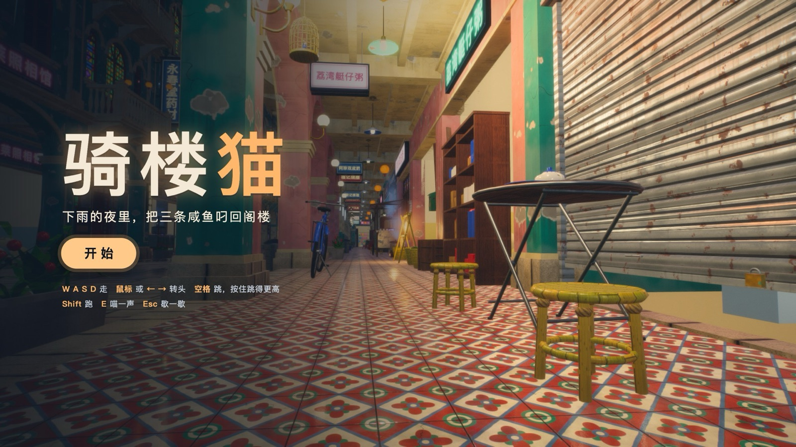
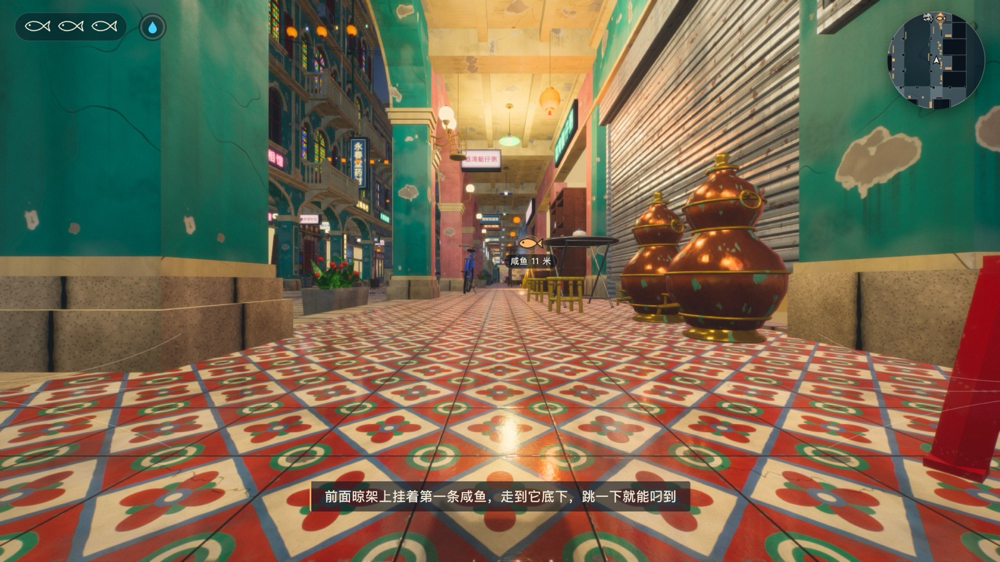

# 骑楼猫

一个下雨的夜里，广州西关的一条骑楼街。你是一只猫，眼睛离地二十六厘米。街上晾着三条咸鱼，一条比一条高，把它们叼齐，再爬回街东头那扇亮着灯的阁楼窗，游戏就结束了，一局大概三五分钟。猫怕淋雨，在露天待久了身上会湿透，湿透了就得停下来抖一秒水，骑楼和雨棚底下不淋雨，躲一会儿就干了。天会慢慢亮起来，结尾按用时和抖水的次数给个称号，从落汤猫、机灵猫到夜行大师。没有敌人，也不会死。

整个游戏是一个网页文件，`release/qiloumao.html`，一兆出头。里面没有一张图片、一段录音、一个模型文件，打开以后也不联网。你看到的砖墙、花阶砖、满洲窗、招牌上的字，听到的雨声、猫叫和配乐，都是页面打开的那几秒里现算出来的。不想下载的话，也可以直接打开 https://qiloumao.papertok.ai 在线玩。

这个游戏是五个 AI 照一份约定分头写出来的。约定就是 `CONTRACT.md`，讲清楚谁做什么、各块之间怎么对接，画面、材质、街道、玩法、声音五块同时开工，大约一个小时各自写完，再花半小时拼成一个文件。每一块是怎么做的、还差什么，写在各自的 `NOTES_*.md` 里。

## 怎么玩

把 `release/qiloumao.html` 拖进浏览器就行，直接双击也可以，不需要服务器。建议用电脑上的 Chrome 或 Edge，画面是按 1920×1080、每秒六十帧调的。手机也能开，会自动降一档画质，换成屏幕上的摇杆和按钮。

| 操作 | 键盘和鼠标 | 触屏 |
|---|---|---|
| 走 | W A S D，方向键上下也能前后走 | 左手拖动 |
| 转头 | 鼠标，或者方向键左右、J 和 L | 右手滑动 |
| 跑 | 按住 Shift | 左手推到底 |
| 跳 | 空格，按住跳得更高 | 跳 |
| 喵一声 | E，或者点一下鼠标 | 喵 |
| 歇一歇 | Esc | |

路线是这样安排的。第一条鱼挂在出生点前面的晾架上，走到底下跳一下就够得着。第二条在街对面的红雨棚顶上，要踩着木箱和三轮车上的货一级一级跳上去。第三条在二楼阳台，从雨棚跳上空调罩，再上竹棚，一路走到头翻过栏杆。最后踩着阳台上的木箱、空调罩和小雨棚爬到屋檐，顺着屋檐走到阁楼窗口。掉下去不要紧，摔不坏，重新爬就是。屏幕下方一直有一行提示告诉你下一步去哪。

2026 年 11 月加了认路的标记，人和 AI 都能用。下一条鱼的位置上浮着一条发光的小鱼，下面写着离你还有几米、要往上几米；要往高处爬时，它先用爪印指下一步落脚的台子（先上木箱、先上红雨棚），站上去再指下一个；鱼在画面外或者在身后时，标记贴在屏幕左边或右边，箭头指着该转的方向。右上角一张圆形小地图跟着猫转，上方就是猫面朝的方向，琥珀色的块是比脚下高一点、跳得上去的台子。网址后面加 `guide=0` 就关掉，回到原来的画面。

## 怎么改，怎么重新打包

源码在 `src/` 里，十六个文件，六千行出头，引擎是 three.js r180。开发时用 `dev.html`，它按模块一个个加载源码，所以要先在这个文件夹里起一个静态服务器，比如 `python3 -m http.server 5208 --bind 127.0.0.1`，再打开 `http://127.0.0.1:5208/dev.html`。

改完以后跑 `node tools/build.mjs`（或者 `npm run build`）。它用 esbuild 把源码和 three.js 压成一段脚本，塞进同一个网页，写到 `dist/index.html`，再抄一份到 `release/qiloumao.html`，最后自己检查一遍文件里有没有外链、图片和联网请求。

`tools/shot.py` 是给不看屏幕的人用的。它打开指定的页面，等画面稳定，截一张图，再把报错、三角形数、绘制次数、帧率和画面平均亮度打印出来，还可以带一段脚本进去按键或者读数据。这个项目里所有的检查都是靠它做的。它要用 Playwright，文件开头写了用 uv 一条命令跑起来的写法；看打包好的单文件不用起服务器，用 `--url` 把 `release/qiloumao.html` 的 file:// 地址传进去就行。

## 藏起来的参数

在网址后面加问号和参数就能用，开发页和打包后的文件都认。

| 参数 | 作用 |
|---|---|
| `autostart=1` | 跳过标题，直接开始 |
| `show=名字` | 单看一个模块的陈列室，名字可以是 render、mats、signs、arch、props、ground、level、fx、audio、player、hud |
| `cam=x,y,z,lx,ly,lz` | 把镜头钉在一个位置，看向一个点 |
| `q=low` `medium` `high` `ultra` | 画质档位 |
| `seed=数字` | 换一个随机种子，街上的细节会跟着变 |
| `noaudio=1` | 不出声 |
| `guide=0` | 关掉认路的标记和小地图 |
| `r_dawn=0` 到 `1` | 把天色固定在夜里到日出之间的某一刻 |
| `post=0`、`bloom=0` | 关掉后期处理，或者只关光晕 |
| `lights=0` 到 `8`、`lv_light=1.3` | 跟着镜头走的真实灯的数量和亮度 |
| `paws=0`、`pshadow=0` | 不画猫爪，不画猫影子 |
| `show=player&ppos=x,y,z&pyaw=弧度` | 把猫直接放到某个位置 |
| `show=hud&hud=title` | 单看一个界面，还可以换成 play、pause、end |
| `show=level&lv_u=0.5` | 标题镜头停在路线的某一点，0 是起点，1 是终点 |

还有一些更细的调试参数，写在各个模块自己的 `NOTES_*.md` 里。

想让程序自己把整条路线走一遍，可以在浏览器控制台里敲 `__G.game.selfTest()`，它会用游戏里真正的那套控制器走完全程，告诉你每一跳成没成。

## 这些东西是怎么算出来的

材质是显卡画的。每种材料有一小段着色器程序，开场时往贴图里画一遍，颜色、粗糙度、凹凸各一张，四十种材料共用三十二套贴图。花阶砖的花、麻石的缝、墙皮剥落的边、满洲窗的彩色玻璃格子都出自这里。淋湿以后朝上的面会变深变亮，这是在同一段程序里实时算的。

招牌上的字是用浏览器自带的画布和系统字体写的，写完拼进几张大图。霓虹灯的灯管和光晕、灯箱的脏迹、木匾上的毛笔字和掉漆，是在写字的同一步里画出来的。

房子和街上的东西是用方块、圆柱、旋转体这些基本形状拼的。骑楼有四种样式，拱券、柱子、线脚、山花、趟栊门、阳台栏杆按参数生成，同一种样式换个种子细节就不一样。竹椅、三轮车、粥档、铜凉茶壶、鸟笼这二十八种小物件也是这么来的。街道的布局写在一张表里，哪栋楼几开间、招牌挂哪、东西摆哪。全部摆好以后，同一种材质的几何体会合并成一块，所以整条街五十多万个三角形，主画面只要一百次左右的绘制。

地面单独处理。路上哪里有积水是开场时算好的一张图，雨点砸出的水圈在着色器里画，水里的倒影是把整条街上下颠倒再画一遍得到的。雨丝、溅起的水花、屋檐的滴水、粥锅的热气是几千个小面片，知道自己在不在屋檐底下。

天空是一段着色器，有云、月亮、远处城市的光和东边慢慢亮起来的天色。全街同时亮着的真实灯只有八盏，会跟着镜头挪到最近的灯位上，其余发光的东西靠自发光加一层光晕。

声音是一个采样一个采样算出来的。雨声、脚步、猫叫、抖水、叼到鱼的那一声、霓虹灯的嗡嗡声、粥锅、钟表铺的钟、闸门后面的收音机，一共三十五种，配乐分四层，叼到的鱼越多层次越厚。街上的声音有位置，走近了才听得清。

猫自己只有两只前爪和一团影子。爪子在跑和跳的时候伸进画面底部，影子是画布上画的一个猫形，贴在脚下的地面上。屏幕上的三条鱼、淋湿的圆环、提示和两边的胡须是普通的网页元素和矢量图形。

## 现在的数字

`release/qiloumao.html` 是 1,065,965 字节（加认路标记之前是 1,057,768）。源码 6,147 行。在一台 M4 的 MacBook Air 上用 1920×1080 的高画质跑，每秒六十帧，画面里大约 56 万个三角形，出生点那个视角主画面绘制 110 次，加上倒影和后期一共 223 次。这些是在无界面的 Chrome 里量的。

## 没做完的地方

没有真人完整玩过。路线、淋雨、各个界面是靠脚本验证的，脚本会点开始按钮，用真实的按键事件一路走到结尾。鼠标视角、指针锁定和触屏操作没有在真机上试过。声音只看过波形和数字，没有人戴着耳机听过。猫没有身体和尾巴，叼到的鱼只在屏幕上计数。更细的清单在各个 `NOTES_*.md` 里。

## 许可

代码按 MIT 许可开源，全文在 `LICENSE` 里。可以拿去用、改、做成别的东西，商用也可以，只要留着里面的版权声明。`vendor/` 里的 three.js 同样是 MIT 许可，版权属于 three.js 的作者们，打包出来的 `release/qiloumao.html` 末尾也留着它的版权声明。

## English

A rainy night on an arcade street (qilou) in Guangzhou's old Xiguan district. You are a cat: grab the three salted fish hung at rising heights, then climb back to the lit attic window. The whole game is one HTML file of about 1 MB (`release/qiloumao.html`) with no images, recordings or model files. Textures, shop signs, rain, the cat's meows and the music are all generated in the browser when the page opens. Open the file in desktop Chrome or Edge, or play online at https://qiloumao.papertok.ai.

The source is in `src/` (three.js r180); `node tools/build.mjs` rebuilds the single file. Five AI agents wrote it in parallel from one interface contract (`CONTRACT.md`), each module documented in its `NOTES_*.md`. MIT licensed.
